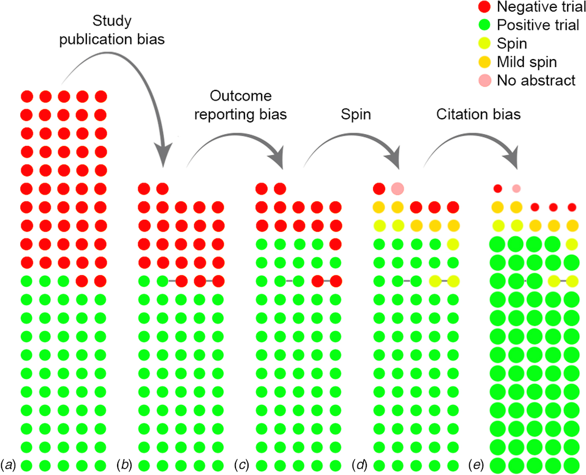

```{r setup}
library(ggplot2)
library(dplyr)
theme_set(theme_minimal(base_size = 18))
set.seed(313)
# cividis: navy, slate, gray, khaki, gold, yellow (viridisLite::cividis(9)[c(1, 3, 5, 6, 7, 9)])
navy <- "#00204D"; slate <- "#414D6B"; cgray <- "#7C7B78"; khaki <- "#9B9477"; gold <- "#BCAF6F"; yellow <- "#FFEA46"
two <- c(navy, gold)               # the two groups, wherever there are two
# charts on dark (.inverse) slides: white text on the navy background, yellow and gold for the two groups
dark <- theme(text = element_text(color = "white"), axis.text = element_text(color = "white"),
              legend.text = element_text(color = "white"), plot.title = element_text(color = "white"),
              panel.grid.major = element_line(color = slate), panel.grid.minor = element_blank(),
              plot.background = element_rect(fill = navy, color = NA),
              panel.background = element_rect(fill = navy, color = NA),
              legend.background = element_rect(fill = navy, color = NA),
              legend.key = element_rect(fill = navy, color = NA))

# Causal graphs. Nodes are letters in circles, or words in boxes (boxes = TRUE).
# A node's size is fixed on the page, in inches, while the figure's size decides how
# many inches a data unit is. draw_dag measures both on the graphics device open when it
# is called (in a rendered document, the chunk's figure) and stops every arrow `gap`
# inches short of the two nodes it joins. Arrows listed in `dashed` are dashed; arrows
# listed in `highlight` are gold. One panel per value of `panel`. (From week 3.)
draw_dag <- function(nodes, edges, dashed = character(0), highlight = character(0), boxes = FALSE,
                     text_size = 7, xlim = c(-0.5, 2.5), ylim = c(-0.4, 1.4), strip_size = 18,
                     gap = 0.05) {
  if (!"panel" %in% names(nodes)) { nodes$panel <- ""; edges$panel <- "" }
  pad <- unit(0.35, "lines"); border <- 0.5; dot <- 16; stroke <- 0.8; lw <- c(black = 0.7, gold = 1.5)
  p <- ggplot() +
    facet_wrap(~ panel, nrow = 1) +
    coord_fixed(xlim = xlim, ylim = ylim) +
    theme_void() +
    theme(strip.text = element_text(size = strip_size), panel.spacing = unit(1.5, "lines"))
  p <- if (boxes) {
    p + geom_label(data = nodes, aes(x, y, label = name), size = text_size, label.size = border,
                   label.padding = pad)
  } else {
    p + geom_point(data = nodes, aes(x, y), size = dot, shape = 21, fill = "white", stroke = stroke) +
      geom_text(data = nodes, aes(x, y, label = name), size = text_size, parse = TRUE)
  }
  inch <- function(u, f) f(u, "in", valueOnly = TRUE)
  g <- ggplotGrob(p)
  pp <- ggplot_build(p)$layout$panel_params[[1]]
  per_unit <- min((dev.size("in")[1] - sum(inch(g$widths, grid::convertWidth))) /
                    (length(unique(nodes$panel)) * diff(pp$x.range)),
                  (dev.size("in")[2] - sum(inch(g$heights, grid::convertHeight))) / diff(pp$y.range))
  if (boxes) {
    text <- lapply(as.character(nodes$name), grid::textGrob, gp = grid::gpar(fontsize = text_size * .pt))
    nodes$hw <- (sapply(text, \(t) inch(grid::grobWidth(t), grid::convertWidth)) / 2 +
                   inch(pad, grid::convertWidth) + border * .pt / 96 / 2) / per_unit
    nodes$hh <- (sapply(text, \(t) inch(grid::grobHeight(t), grid::convertHeight)) / 2 +
                   inch(pad, grid::convertHeight) + border * .pt / 96 / 2) / per_unit
  } else {
    nodes$hw <- nodes$hh <- (0.375 * (dot * .pt + stroke * .stroke / 2) / 72 +
                               stroke * .stroke / 2 / 96 / 2) / per_unit
  }
  e <- edges |>
    left_join(nodes, by = c("panel", "from" = "name")) |>
    rename(x0 = x, y0 = y, hw0 = hw, hh0 = hh) |>
    left_join(nodes, by = c("panel", "to" = "name")) |>
    mutate(dx = x - x0, dy = y - y0, len = sqrt(dx^2 + dy^2), ux = dx / len, uy = dy / len,
           col = ifelse(paste(from, to) %in% highlight, "#BCAF6F", "black"),
           style = ifelse(paste(from, to) %in% dashed, "dashed", "solid"),
           g0 = gap / per_unit,
           g1 = (gap + ifelse(col == "black", lw[["black"]], lw[["gold"]]) * .pt / 96 / 2) / per_unit,
           s0 = if (boxes) pmin((hw0 + g0) / pmax(abs(ux), 1e-9), (hh0 + g0) / pmax(abs(uy), 1e-9)) else hw0 + g0,
           s1 = if (boxes) pmin((hw + g1) / pmax(abs(ux), 1e-9), (hh + g1) / pmax(abs(uy), 1e-9)) else hw + g1,
           xs = x0 + s0 * ux, ys = y0 + s0 * uy, xe = x - s1 * ux, ye = y - s1 * uy)
  p + geom_segment(data = e, aes(x = xs, y = ys, xend = xe, yend = ye, linetype = style, color = col),
                   arrow = arrow(length = unit(0.25, "cm"), type = "closed"),
                   linewidth = ifelse(e$col == "black", lw[["black"]], lw[["gold"]]), show.legend = FALSE) +
    scale_linetype_identity() + scale_color_identity()
}

# Labels with math letters, for the reinforcement-learning figures (from week 3). In
# `label`, the text between dollar signs is drawn in MathJax_Math, the TeX italic of an
# older MathJax, which looks like the italic of the slides' formulas; the rest is drawn
# in the device's default font. A label cannot hold a literal dollar sign.
GeomMathText <- ggproto("GeomMathText", Geom,
  required_aes = c("x", "y", "label"),
  default_aes = aes(colour = "black", size = 6, hjust = 0.5, vjust = 0.5),
  draw_key = draw_key_text,
  draw_panel = function(data, panel_params, coord, nudge_y = 0) {
    data <- coord$transform(data, panel_params)
    labels <- lapply(seq_len(nrow(data)), function(i) {
      d <- data[i, ]
      parts <- strsplit(as.character(d$label), "$", fixed = TRUE)[[1]]
      math <- seq_along(parts) %% 2 == 0
      keep <- nzchar(parts)
      if (!any(keep)) return(grid::nullGrob())
      font <- function(m) grid::gpar(col = d$colour, fontsize = d$size * .pt,
                                     fontfamily = if (m) "MathJax_Math" else "",
                                     fontface = if (m) "italic" else "plain")
      pieces <- unname(Map(function(p, m) grid::textGrob(p, gp = font(m)), parts[keep], math[keep]))
      widths <- lapply(pieces, grid::grobWidth)
      x <- unit(d$x, "native") - d$hjust * Reduce(`+`, widths)
      y <- unit(d$y, "native") + unit(nudge_y, "pt") -
        d$vjust * grid::grobHeight(grid::textGrob("M", gp = font(FALSE)))
      for (k in seq_along(pieces)) {
        pieces[[k]] <- grid::editGrob(pieces[[k]], x = x, y = y, just = c("left", "bottom"))
        x <- x + widths[[k]]
      }
      grid::gTree(children = do.call(grid::gList, pieces))
    })
    grid::gTree(children = do.call(grid::gList, labels))
  }
)
geom_mathtext <- function(mapping = NULL, data = NULL, ...) {
  layer(geom = GeomMathText, mapping = mapping, data = data, stat = "identity",
        position = "identity", show.legend = FALSE, inherit.aes = FALSE, params = list(...))
}
if (requireNamespace("systemfonts", quietly = TRUE) &&
    !"MathJax_Math" %in% systemfonts::system_fonts()$family) {
  stop("The font MathJax_Math is not installed. It draws the math letters in this file's ",
       "figures (on Debian or Ubuntu: apt-get install fonts-mathjax).")
}

# The stylized version of the health-care case: need Y* standard normal in both groups,
# Y = Y* + bA, selection above t, the 97th percentile when b = 0.
t97 <- qnorm(0.97)
sel <- function(b) {                       # for group A = 1 with offset b, against A = 0
  z0 <- t97; z1 <- t97 - b
  s0 <- 1 - pnorm(z0); s1 <- 1 - pnorm(z1)
  data.frame(b = b, share0 = s0, share1 = s1, ratio = s1 / s0,
             need0 = dnorm(z0) / s0, need1 = dnorm(z1) / s1)
}
```

## {.inverse}

::: {.notes}
Compress: the four parts. Plan 62 in the 80: opener 2, scores 8, cost as a proxy for need 21, what gets rewarded 12, systems that adapt 13, close 6; then 18 of slack. Dark = rush or skip.

Cut order: (1) the two-models slide; (2) the engagement slide; (3) the commentary on the citation figure, keeping the figure; (4) attenuation and the slide after it, which the class works anyway. Do not cut the predictions before the table and the simulation, the job center, the written close or the question at the end.

Pace: 0:10 Part 2; 0:31 Part 3; 0:43 Part 4; 0:56 lenses; 1:02 end.
:::

### Week 4

Part 1: Scores

Part 2: Cost as a proxy for need

Part 3: What gets rewarded

Part 4: Systems that adapt

## A score

::: {.notes}
One line each, two minutes. Keep the slips: the sorting slide at the end of part 1 uses them, and the written close comes back to them.
:::

::: {.ask}
Write down one score that has been used on you: a grade, a credit score, a ranking, a rating. What did it measure? What was it taken to stand for?
:::

# Part 1: Scores

## Citation counts

::: {.notes}
The week 1 filter again, three stages further down the pipeline. 105 trials; 77 published, 98% of the positive and 48% of the negative; ten negative trials turned positive by outcome switching; spin; positive trials cited 92 times to 32.
:::

{fig-align="center" height="470"}

::: {.source}
de Vries, Roest, de Jonge, Cuijpers, Munafò and Bastiaansen (2018), *Psychological Medicine* 48(15), 2453--2455, doi:10.1017/S0033291718001873, Figure 1 (CC BY 4.0): 105 antidepressant trials, from the FDA's record to the literature.
:::

## What a score does to the people it is applied to

::: {.notes}
Week 2's sentence. Goodhart was writing about monetary policy; Strathern about university audits. The p-hacking loop is the first case: the score was p < 0.05, and the people measured responded.
:::

> "Any observed statistical regularity will tend to collapse once pressure is placed upon it for control purposes." Goodhart (1975)

> "When a measure becomes a target, it ceases to be a good measure." Strathern (1997)

What a score does to the people who write for it is a different mechanism from selection.

::: {.retrieval}
A researcher tries comparisons until one gives $p < 0.05$. Which is the score, and which is the thing it stood for?
:::

::: {.source}
Goodhart, "Problems of Monetary Management: The UK Experience," *Papers in Monetary Economics* 1, Reserve Bank of Australia (1975), quoted from the 1981 reprint (ed. Courakis), p. 116, as the Wikipedia article "Goodhart's law" (revision of 9 October 2026) gives it; not checked against the paper. Strathern, "'Improving ratings': audit in the British University system," *European Review* 5(3), 305--321 (1997), p. 308.
:::

## Measured and intended

::: {.notes}
Y is what gets recorded; Y* is what we wanted. Three minutes: the room sorts its own scores into the table's two columns, and says which route makes them differ.
:::

$Y$ is the outcome we measure. $Y^\star$ is the outcome we intend: the one we would use if we could.

| $Y$, measured | $Y^\star$, intended |
|:---|:---|
| citations | contribution to knowledge |
| $p < 0.05$ | a true effect |
| last week's job center: its placement rate | people in work because of the course |
| a patient's medical cost | how ill the patient is |
| a video's views | a viewer informed, or entertained, on their own terms |

::: {.ask}
Your score from the start: which column is it in, and what is the other column?
:::

# Part 2: Cost as a proxy for need

## A risk score in health care

::: {.notes}
Obermeyer and colleagues studied one tool at one academic hospital: 6,079 Black and 43,539 White patients, 2013 to 2015. The label the model predicts is next year's medical cost. Race is not an input.
:::

A hospital uses a commercial risk score to decide who is offered extra care. Patients above the 97th percentile are identified for a care program automatically; those above the 55th are flagged to their doctor.

The score predicts **next year's medical cost**. Race is not one of its inputs.

By industry estimates, tools of this class are applied to roughly 200 million people in the United States each year.

::: {.source}
Obermeyer, Powers, Vogeli and Mullainathan (2019), "Dissecting racial bias in an algorithm used to manage the health of populations," *Science* 366(6464), 447--453, doi:10.1126/science.aax2342; free full text at escholarship.org/uc/item/6h92v832.
:::

## Sketch it

::: {.notes}
Everyone draws before the next slide: the number of chronic conditions a patient has against the score, one curve for each group. Then hands: the same curve, or different?
:::

```{r sketch_axes, fig.height=3.6, fig.alt="Empty axes: algorithm risk score, percentile, on the x axis from 0 to 100, and number of active chronic conditions on the y axis; a dashed vertical line at the 97th percentile."}
ggplot() +
  geom_vline(xintercept = 97, linetype = "dashed", color = cgray) +
  annotate("text", x = 95, y = 5.5, label = "97th", hjust = 1, color = cgray, size = 6) +
  scale_x_continuous(limits = c(0, 100), breaks = seq(0, 100, 25)) +
  scale_y_continuous(limits = c(0, 6), breaks = 0:6) +
  labs(x = "risk score (percentile)", y = "active chronic conditions") +
  theme(panel.grid.minor = element_blank())
```

::: {.ask}
If cost tracked need equally for Black and White patients, what would the two curves look like?
:::

## The same score, more illness

::: {.notes}
The paper's Figure 1A: conditions rise with the score in both groups, and the Black curve lies above the White one at every percentile. At the 97th, 4.8 against 3.8 conditions, 26% more at the same score. The curves here are a sketch of that shape, not the paper's data.
:::

```{r obermeyer_curves, fig.height=4.0, fig.alt="Two rising curves of active chronic conditions against risk-score percentile on the axes the room drew, the Black patients' curve above the White patients' at every percentile; at the dashed 97th-percentile line the curves are labeled 4.8 and 3.8."}
pct <- seq(0, 100, by = 1)
# a sketch of the paper's Figure 1A: conditions rising with the score, the Black curve one
# condition above the White one, both through the paper's numbers at the 97th percentile
white <- 0.6 + 3.4 * (pct / 100)^2
curves <- bind_rows(data.frame(pct = pct, cond = white + 1.0, group = "Black patients"),
                    data.frame(pct = pct, cond = white, group = "White patients"))
curves$group <- factor(curves$group, levels = c("Black patients", "White patients"))
ggplot(curves, aes(pct, cond, color = group)) +
  geom_vline(xintercept = 97, linetype = "dashed", color = cgray) +
  geom_line(linewidth = 1.3) +
  annotate("label", x = 97, y = c(5.4, 3.1), label = c("4.8", "3.8"), size = 6, color = two, label.size = 0) +
  scale_color_manual(values = two, name = NULL) +
  scale_x_continuous(limits = c(0, 100), breaks = seq(0, 100, 25)) +
  scale_y_continuous(limits = c(0, 6), breaks = 0:6) +
  labs(x = "risk score (percentile)", y = "chronic conditions", caption = "a sketch of the paper's Figure 1A, through its two numbers at the 97th percentile") +
  theme(panel.grid.minor = element_blank(), legend.position = c(0.2, 0.85), legend.text = element_text(size = 15),
        axis.title.y = element_text(size = 15), plot.caption = element_text(size = 12, color = cgray))
```

At every level of the score, the Black patients it selects are sicker.

::: {.source}
Obermeyer and colleagues (2019), Figure 1A and text: 4.8 against 3.8 conditions at the 97th percentile ($P < 0.001$).
:::

## A model: an offset for one group

::: {.notes}
Need is the same in both groups; cost is need plus an offset b for group 1, negative here. Selecting above t on Y is selecting above t minus b on need, for that group only. An offset in the measure is a threshold moved for one group. Then everyone predicts, from the moved threshold, before the table: hands for "less often", and one reason.
:::

$Y^\star$ need, assumed here to be the same in both groups; $A = 1$ for one group, $0$ for the other; selected if $Y > t$, where $Y = Y^\star + bA$.

```{r offset_densities, fig.height=1.9, fig.alt="Two normal curves of the measure Y, the group-1 curve shifted left by half a standard deviation, with the threshold t drawn as a dashed line and the two tails above it shaded."}
grid <- seq(-3.5, 3.5, length.out = 400)
dens <- bind_rows(data.frame(y = grid, d = dnorm(grid), group = "group 0"),
                  data.frame(y = grid, d = dnorm(grid, mean = -0.5), group = "group 1"))
ggplot(dens, aes(y, d, color = group)) +
  geom_area(data = filter(dens, y > t97), aes(fill = group), alpha = 0.4, position = "identity", color = NA) +
  geom_line(linewidth = 1) +
  geom_vline(xintercept = t97, linetype = "dashed", color = cgray) +
  annotate("text", x = t97 + 0.1, y = 0.37, label = "t", hjust = 0, size = 7, fontface = "italic") +
  scale_color_manual(values = two, name = NULL) + scale_fill_manual(values = two, name = NULL) +
  labs(x = "the measure Y, with b = -0.5 standard deviations", y = NULL) +
  theme(axis.text.y = element_blank(), panel.grid = element_blank(),
        legend.position = c(0.12, 0.85), legend.text = element_text(size = 15),
        axis.title.x = element_text(size = 15))
```

For group $1$, $Y > t$ is $Y^\star > t - b$: a threshold moved for that group.

::: {.ask}
With $b = -0.5$: is group $1$ selected more or less often?
:::

## Who is selected, and how ill

::: {.notes}
Standard normal need, t at the 97th percentile. Share selected, the ratio, and the mean need of the selected: the inverse Mills ratio, which in week 1 gave the expected size of an estimate that survived the significance filter. A half-standard-deviation offset cuts group 1's chance of selection to a third and makes its selected members sicker. The paper's Figure 1A compares at the same score, not above a threshold; in this model that gap is exactly -b.
:::

$Y^\star \sim N(0, 1)$ in both groups; $t$ is the 97th percentile.

```{r sel_table, results="asis"}
tab <- bind_rows(sel(0), sel(-0.5), sel(-1))
cat("| offset $b$ | selected, group 0 | selected, group 1 | ratio | mean need of selected in group 0 | mean need of selected in group 1 |\n|:---|:---|:---|:---|:---|:---|\n")
for (i in seq_len(nrow(tab))) with(tab[i, ], cat(sprintf("| %s | %.1f%% | %.1f%% | %.2f | %.2f | %.2f |\n",
  format(b, nsmall = 1), 100 * share0, 100 * share1, ratio, need0, need1)))
```

::: {.leave}
With $b < 0$, group $1$ is selected with probability $P(Y^\star > t - b) < P(Y^\star > t)$, and its selected members have higher mean need than group $0$'s.
:::

::: {.retrieval}
The mean of a standard normal above $z$ is $\phi(z)/(1 - \Phi(z))$. Where did that appear before?
:::

## Changing the label

::: {.notes}
The authors simulate: with the gap removed, Black patients would be 46.5% of those identified automatically instead of 17.7%. Separately, Table 2: models trained on three labels. Chronic conditions as the label nearly doubles the Black share of the highest-risk group. Then hands for each label, and one reason: who is worse off under the label you chose?
:::

Removing the gap between the groups, in a simulation: the share of Black patients among those identified automatically rises from **17.7% to 46.5%**.

Training a new model on each of three labels (the paper's Table 2), the Black share of patients above the 97th percentile:

| label | Black share |
|:---|:---|
| total cost | 14.1% |
| avoidable cost | 21.0% |
| active chronic conditions | 26.7% |

::: {.ask}
Which label would you choose for this program, and who is worse off under it?
:::

::: {.source}
Obermeyer and colleagues (2019), body text and Table 2. The abstract states the first figure loosely, as "the percentage of Black patients receiving additional help"; the body states it as the Black share of those auto-identified at the 97th percentile.
:::

## Why cost is lower at the same need

::: {.notes}
At the same number of chronic conditions, Black patients generated about $1,801 less a year. Everyone in the sample was insured. Access: poverty, geography, transport, work, knowing when to seek care. And direct effects of race on care. The label was a reasonable choice for a program meant to cut costs; it was still a choice.
:::

At the same number of chronic conditions, Black patients in the sample generated about **$1,801 less** in medical costs a year. Everyone in the sample was insured.

Two routes the authors name: barriers to care (poverty, geography, transport, work and child care, knowing when to seek care), and the effect of race on the care a patient receives.

::: {.ask}
What are we optimizing or predicting? Who chose cost as the label, and why?
:::

## Who bears the error

::: {.notes}
The threshold makes two errors: selected though not ill enough to need it, and left out though ill. A percentile fixes the trade between them without saying how it was valued; a budget for places would fix it too. The score's offset moves the second error onto one group. Then the standing question: whose proxy, who chose it, who benefited from the choice being invisible. Three minutes with hands.
:::

| | selected | not selected |
|:---|:---|:---|
| **ill enough to need the program** | right | left out |
| **not** | a place used | right |

A threshold $t$ trades the two errors. An offset $b$ in the measure moves the second error, being left out though ill, onto the group with the offset.

::: {.ask}
Who benefited from that choice being invisible? And would a more competent analyst have chosen differently?
:::

## A noisy measure flattens a slope

::: {.notes}
The hospital has cost and wants need. Classical measurement error, the third route by which Y and Y* differ: the best guess of need from the measure is the measure shrunk by lambda, the share of the measure's variance that is need. Two units above average in cost, one unit above average in need. The top of the score is less extreme in need than it looks; part 4 uses this. The class derives it. Variance in the measure becomes bias in the slope.
:::

$Y = Y^\star + \varepsilon$, noise independent of need. The best guess of need from the measure (normal case) is
$$
E[Y^\star \mid Y = y] = \lambda y, \qquad \lambda = \frac{\operatorname{Var}(Y^\star)}{\operatorname{Var}(Y^\star) + \operatorname{Var}(\varepsilon)} < 1 .
$$

```{r attenuation, fig.width=5.5, fig.height=3.0, out.width="52%", fig.align="center", fig.alt="A scatterplot of need against the noisy measure, with the fitted line of slope one half flatter than the dashed identity line."}
n <- 400
ystar <- rnorm(n); eps <- rnorm(n)
att <- data.frame(y = ystar + eps, ystar = ystar)
ggplot(att, aes(y, ystar)) +
  geom_abline(slope = 1, intercept = 0, linetype = "dashed", color = cgray) +
  geom_point(alpha = 0.3, size = 1.2, color = slate) +
  geom_smooth(method = "lm", se = FALSE, color = gold, linewidth = 1.4) +
  annotate("text", x = 2.3, y = 0.4, label = "slope 1/2", color = gold, size = 5.5, hjust = 0) +
  annotate("text", x = -3.4, y = -2.0, label = "need = measure", color = cgray, size = 4.5, hjust = 0) +
  coord_cartesian(xlim = c(-3.5, 3.9), ylim = c(-3, 3)) +
  labs(x = "the measure Y", y = "need Y*", caption = "Var(Y*) = Var(noise) = 1, so lambda = 1/2") +
  theme(plot.caption = element_text(size = 12, color = cgray))
```

## Noise and an omitted variable

::: {.notes}
Last week's omitted-variable bias, with a noisy measure. Does care improve health? Y here is health, an outcome, not the measure of need. Visits are reported with error, independent of everything else (U is everything else that affects health, also independent), which shrinks the slope by lambda; illness is not in the data, brings more visits and worse health, and adds gamma times delta. Pairs, one minute, on the question; then the figure. Classical noise in the report never changes the sign, since lambda is positive; the left-out variable can. When gamma delta is positive, as with ability and schooling, the two pull against each other and the slope can be too large or too small. Lens F: the slope is read as the effect of a visit with illness held fixed. The class derives the formula.
:::

Health $Y$; visits $X^\star$, reported as $X = X^\star + \varepsilon$; illness $Z$, not in the data.
$$
Y = \beta X^\star + \gamma Z + U ,
\qquad
\text{slope of } Y \text{ on } X = \lambda\,(\beta + \gamma\delta),
$$
with $\lambda = \operatorname{Var}(X^\star)/\operatorname{Var}(X)$ and $\delta = \operatorname{Cov}(X^\star, Z)/\operatorname{Var}(X^\star)$.

::: {.ask}
Visits help, $\beta > 0$. The ill visit more and are less healthy next year. Can the slope be negative? Can noise make it so?
:::

. . .

```{r noise_ovb, fig.width=8.5, fig.height=2, out.width="88%", fig.alt="The slope of health on reported visits against lambda, from 0 to 1, for three values of gamma times delta with beta equal to one half. With gamma delta 0.25 the line rises to 0.75 and crosses beta at lambda two thirds; with minus 0.25 it rises to 0.25, below beta; with minus 1 it falls to minus 0.5, below zero for every lambda."}
beta <- 0.5
cases <- data.frame(gd = c(0.25, -0.25, -1), col = c(gold, slate, navy))
lines <- do.call(rbind, lapply(seq_len(nrow(cases)), function(i)
  data.frame(lambda = c(0, 1), slope = c(0, 1) * (beta + cases$gd[i]), gd = cases$gd[i], col = cases$col[i])))
ends <- data.frame(x = 1.03, y = beta + cases$gd, col = cases$col,
                   label = sprintf("$\u03b3\u03b4$ = %s", sub("-", "\u2212", as.character(cases$gd))))
regions <- data.frame(x = 0.02, y = c(0.66, 0.36, -0.3), label = c("too large", "too small", "wrong sign"))
ggplot(lines, aes(lambda, slope, group = gd)) +
  annotate("segment", x = 0, xend = 1, y = beta, yend = beta, linetype = "dashed", color = cgray) +
  annotate("segment", x = 0, xend = 1, y = 0, yend = 0, color = cgray, linewidth = 0.3) +
  geom_line(aes(color = col), linewidth = 1.4) +
  scale_color_identity() +
  geom_mathtext(data = ends, aes(x, y, label = label, colour = col), size = 5.2, hjust = 0) +
  geom_mathtext(data = data.frame(x = 1.03, y = beta, label = "$\u03b2$, the effect"),
                aes(x, y, label = label), colour = cgray, size = 4.6, hjust = 0) +
  annotate("text", x = regions$x, y = regions$y, label = regions$label, hjust = 0, color = cgray, size = 4.6, fontface = "italic") +
  scale_x_continuous(breaks = c(0, 0.5, 1), labels = c("\u03bb = 0", "0.5", "1"), limits = c(0, 1.4)) +
  scale_y_continuous(breaks = c(-0.5, 0, 0.5)) + coord_cartesian(ylim = c(-0.58, 0.8), clip = "off") +
  labs(x = NULL, y = "slope") +
  theme(panel.grid.minor = element_blank(), axis.title = element_text(size = 14), axis.text = element_text(size = 12))
```

# Part 3: What gets rewarded

## Reinforcement learning

::: {.notes}
R is what the system is given, U is what we wanted: Y and Y* again.
:::

**Notation:** in this part, the letters of reinforcement learning: $S$ state, $A$ action, $R$ reward, $\pi$ policy, $U$ utility.

```{r rl_loop, fig.height=1.9, dev.args=list(symbolfamily=grDevices::cairoSymbolFont("MathJax_Math", usePUA=FALSE)), fig.alt="A loop: the agent, with policy pi, sends an action A to the environment, which returns a state S and a reward R to the agent."}
loop_boxes <- data.frame(x = c(0, 3), y = c(0, 0), label = c("atop(agent, policy~pi)", "environment"))
loop_top <- data.frame(x = 0.62, y = 0.28, xend = 2.28, yend = 0.28)
loop_bottom <- data.frame(x = 2.28, y = -0.28, xend = 0.62, yend = -0.28)
loop_text <- data.frame(x = c(1.45, 1.45), y = c(1.12, -1.12),
                        label = c("action $A$", "state $S$, reward $R$"))
ggplot() +
  geom_curve(data = loop_top, aes(x = x, y = y, xend = xend, yend = yend), curvature = -0.35,
             arrow = arrow(length = unit(0.3, "cm"), type = "closed"), linewidth = 0.8) +
  geom_curve(data = loop_bottom, aes(x = x, y = y, xend = xend, yend = yend), curvature = -0.35,
             arrow = arrow(length = unit(0.3, "cm"), type = "closed"), linewidth = 0.8) +
  geom_label(data = loop_boxes, aes(x, y, label = label), parse = TRUE, size = 7,
             label.padding = unit(0.6, "lines"), label.size = 0.6) +
  geom_mathtext(data = loop_text, aes(x, y, label = label), size = 6.5) +
  coord_cartesian(xlim = c(-0.9, 3.9), ylim = c(-1.3, 1.3)) +
  theme_void()
```

Learning: change $\pi$ to make the expected reward $E_\pi[R]$ large.

A utilitarian wants the largest $E_\pi[U]$, with $U$ the good we care about. The agent is given $R$.

## A cleaning robot

::: {.notes}
A toy that runs through the paper by Amodei and colleagues. All three earn full reward; only one cleans the room. The reward is what the robot can check; the utility is what its owner wants.
:::

**Notation:** reinforcement learning ($S$, $A$, $R$, $\pi$, $U$).

:::: {.columns}
::: {.column width="50%"}
- $S$: the camera's view
- $A$: move, or clean
:::
::: {.column width="50%"}
- $R$: 1 if no mess in view
- $U$: a clean room
:::
::::

```{r robot, fig.width=8, fig.height=2.5, fig.alt="Three rooms, each earning reward 1. Left: the robot cleans, and its view shows no mess. Middle: it closes its eyes, and the mess stays. Right: it covers the mess, which stays under the cover."}
panels <- c("cleans", "closes its eyes", "covers the mess")
room <- data.frame(panel = factor(panels, levels = panels))
cone <- do.call(rbind, lapply(panels[c(1, 3)], function(p)
  data.frame(panel = p, x = c(2.6, 9.6, 9.6), y = c(2.3, 7.4, 3.0))))
mess <- data.frame(panel = rep(panels[2:3], each = 2), x = c(7.6, 8.4, 7.6, 8.4), y = c(5.0, 4.3, 5.0, 4.3))
cover <- data.frame(panel = panels[3], xmin = 6.5, xmax = 9.7, ymin = 3.2, ymax = 6.1)
caption <- data.frame(panel = panels, x = 5, y = -1.6,
                      label = c("$R$ = 1, room clean", "$R$ = 1, room dirty", "$R$ = 1, room dirty"))
for (d in c("cone", "mess", "cover", "caption")) {
  z <- get(d); z$panel <- factor(z$panel, levels = panels); assign(d, z)
}
ggplot() +
  geom_rect(data = room, aes(xmin = 0, xmax = 10, ymin = 0, ymax = 8), fill = NA, color = slate, linewidth = 0.8) +
  geom_polygon(data = cone, aes(x, y), fill = gold, alpha = 0.5) +
  geom_point(data = mess, aes(x, y), size = 7, color = khaki) +
  geom_rect(data = cover, aes(xmin = xmin, xmax = xmax, ymin = ymin, ymax = ymax), fill = cgray, alpha = 0.8) +
  geom_point(data = data.frame(x = 2, y = 2), aes(x, y), size = 9, color = navy) +
  geom_mathtext(data = caption, aes(x, y, label = label), size = 5.6) +
  facet_wrap(~ panel, nrow = 1) +
  coord_fixed(xlim = c(-0.3, 10.3), ylim = c(-2.4, 8.3)) +
  theme_void() + theme(strip.text = element_text(size = 17), panel.spacing = unit(1.5, "lines"))
```

::: {.source}
Amodei, Olah, Steinhardt, Christiano, Schulman and Mané (2016), "Concrete Problems in AI Safety," sections 2 and 4.
:::

## A job center as an agent

::: {.notes}
Pairs, one minute, then hands for each question. A variant of week 3's table in which the course helps one group more.
:::

**Notation:** reinforcement learning ($S$, $A$, $R$, $\pi$, $U$).

A variant of week 3's job center: 100 places on the course, which helps some people more than others. Take the rates below as what would happen if the course were assigned, or withheld.

| | in work six months later, with the course | without it |
|:---|:---|:---|
| worked last year | 70% | 64% |
| did not | 40% | 14% |

:::: {.columns}
::: {.column width="40%"}
- $S$: a person's record
- $A$: refer or not
:::
::: {.column width="60%"}
- $R$: placement rate, the share of referrals in work
- $U$: extra people in work
:::
::::

::: {.ask}
Who does a center judged on $R$ send? Who would a utilitarian send?
:::

## Cream skimming

::: {.notes}
The numbers are invented, and the quotation is the real case. The same paper finds that cream skimming changed efficiency little either way, and argues that the objection to it is about equity (section VIII).
:::

**Notation:** reinforcement learning ($S$, $A$, $R$, $\pi$, $U$).

```{r skim, fig.height=2.4, fig.alt="Two panels of invented numbers for the variant job center. Placement rate: 70 percent if it sends people who worked last year, 40 percent if it sends those who did not. Extra people in work: 6 against 26."}
skim <- data.frame(group = factor(rep(c("worked last year", "did not"), 2), levels = c("worked last year", "did not")),
                   panel = factor(rep(c("R", "U"), each = 2), levels = c("R", "U")),
                   value = c(70, 40, 6, 26), shown = c("70%", "40%", "6", "26"))
titles <- data.frame(panel = factor(c("R", "U"), levels = c("R", "U")), x = 1.5, y = Inf,
                     label = c("$R$: placement rate", "$U$: extra people in work"))
ggplot(skim, aes(group, value, fill = group)) +
  geom_col(width = 0.6, show.legend = FALSE) +
  geom_text(aes(label = shown), vjust = -0.4, size = 6) +
  geom_mathtext(data = titles, aes(x, y, label = label), size = 17 / .pt, colour = "grey10",
                vjust = 0, nudge_y = 12) +
  facet_wrap(~ panel, scales = "free_y") +
  scale_fill_manual(values = two) +
  scale_y_continuous(expand = expansion(mult = c(0, 0.3))) +
  coord_cartesian(clip = "off") +
  labs(x = "the 100 people sent", y = NULL, caption = "invented numbers: the variant job center") +
  theme(axis.text.y = element_blank(), panel.grid.major = element_blank(), panel.grid.minor = element_blank(),
        strip.text = element_blank(), plot.margin = margin(t = 30, r = 9, b = 9, l = 9),
        axis.title.x = element_text(size = 15), plot.caption = element_text(size = 12, color = cgray))
```

Cream skimming: choosing people who would have found work anyway. In the US Job Training Partnership Act programs, centers were judged on short-run measures ($R$) that were "weakly, and sometimes perversely, related to long run impacts" ($U$).

::: {.source}
Heckman, Heinrich and Smith (2002), "The Performance of Performance Standards," NBER Working Paper 9002, doi:10.3386/w9002, abstract.
:::

## Need, or benefit

::: {.notes}
Back to the hospital with the job center's distinction. The program mostly prevents acute episodes in people with chronic illness, the paper says. The sickest patient and the patient the care would help most are different people when the effect differs by patient, and last week's average treatment effect averaged over such differences. Hands for each, then: telling them apart needs an effect, which is a causal claim; choosing between them is a value judgment about whose good counts.
:::

**Notation:** reinforcement learning ($S$, $A$, $R$, $\pi$, $U$).

The job center chose between two utilities: people likely to be in work, or people the course helps most.

The hospital's program mostly prevents acute episodes in people with chronic illness. Two candidates for $U$: how ill a patient is, and how much the extra care would help them.

Benefit is an effect, a causal question.

::: {.ask}
Should the program go to the sickest, or to those the care would help most? What would you need to know to tell them apart, and what are you deciding when you choose?
:::

## Utilitarianism with a reward

::: {.notes}
Retrieval first: the four difficulties from last week, from the room, before the table. Then each as a choice someone makes when building the agent. The robot and the center are both in the first row; the need-or-benefit question is the first row too.
:::

**Notation:** reinforcement learning ($S$, $A$, $R$, $\pi$, $U$).

An agent judges a policy only by the reward it expects. That is consequentialism, with the good defined by whoever chose $R$.

::: {.retrieval}
Last week listed four difficulties of utilitarianism. Which are they?
:::

. . .

| a difficulty of utilitarianism | in building the agent |
|:---|:---|
| defining utility | someone chooses $R$, and $R$ is not $U$ |
| trading off between people | reward is added up over the people served |
| judging acts or rules | the policy is a rule: it treats alike everyone in the same state |
| predicting consequences | a model of what the actions do, which is a causal model |

# Part 4: Systems that adapt

## When a measure becomes a target

::: {.notes}
Back to the prediction letters. So far the people measured have done nothing; the robot and the job center were the agents. Now the people act. Before the rule: Y comes from need and noise, and selecting on Y is conditioning; the selected are needier on average. After the rule: people add g to Y without touching need, an intervention on Y's equation. The simulation: 300 places by Y, mean need before and after.
:::

Before a rule rewards $Y$: $\;Y = Y^\star + \varepsilon$.

After: each person can add $g \ge 0$ to $Y$, at a cost, without changing $Y^\star$:
$$
Y = Y^\star + \varepsilon + g .
$$

```{r goodhart_dag, fig.height=1.9, fig.alt="Two graphs. Before: need and noise point to the measure Y. After: a third arrow into Y, from effort chosen to raise the measure."}
pn <- c("before the rule", "after the rule")
nodes <- data.frame(panel = c(rep(pn[1], 3), rep(pn[2], 4)),
                    name = c("need", "noise", "Y", "need", "noise", "Y", "effort on Y"),
                    x = c(0, 2.6, 1.3, 0, 2.6, 1.3, 1.3), y = c(1, 1, 0, 1, 1, 0, 1.15))
edges <- data.frame(panel = c(pn[1], pn[1], pn[2], pn[2], pn[2]),
                    from = c("need", "noise", "need", "noise", "effort on Y"),
                    to = c("Y", "Y", "Y", "Y", "Y"))
nodes$panel <- factor(nodes$panel, levels = pn); edges$panel <- factor(edges$panel, levels = pn)
draw_dag(nodes, edges, boxes = TRUE, text_size = 5.5, xlim = c(-0.9, 3.5), ylim = c(-0.3, 1.45), strip_size = 16)
```

Replacing the equation for $Y$ is an intervention. The relation between $Y$ and $Y^\star$ that held before the rule need not hold after it.

## Two ways to respond

::: {.notes}
Pairs, two minutes, before the simulation. In the simulation, who is able to add 1 is unrelated to need. If everyone adds the same amount, the ranking is unchanged and so is the allocation: targeting a measure does not by itself spoil it. If only some can respond, the allocation changes, and it changes toward the people who could respond. Hands on each, then the next slide.
:::

300 places go to the 300 highest $Y$, where $Y = Y^\star + \varepsilon$. Then the rule is announced.

1. Everyone adds $1$ to their $Y$.
2. Half of the people are able to add $1$; the rest cannot.

::: {.ask}
In each case: who gets the places, compared with before? Does the mean need of the people selected change?
:::

## The same score, before and after

::: {.notes}
Need across, the measure up; the dashed line is the cutoff for 300 places, the selected are solid. Everyone adding 1 moves the cloud and the cutoff up together: the same 300 people. When half are able to add 1, the gold cloud rises, the places go mostly to them, and the selected reach further down in need. What changes the allocation is that the response differs between people. Conditioning on Y gave information; intervening on Y's equation changed what the information is.
:::

```{r goodhart_sim, fig.height=3.2, fig.alt="Three scatterplots of the measure Y against need Y*, with the cutoff for 300 places dashed and the selected drawn solid. Before the rule and after everyone adds 1 the same people are selected; after half are able to add 1, the selected are mostly those able, reaching lower need."}
n <- 10000; places <- 300
need <- rnorm(n); noise <- rnorm(n)
can <- rbinom(n, 1, 0.5) == 1                       # able to add 1, unrelated to need
y0 <- need + noise
cases <- list("before the rule" = y0, "everyone adds 1" = y0 + 1,
              "half are able to add 1" = y0 + ifelse(can, 1, 0))
d <- bind_rows(lapply(names(cases), function(k) {
  y <- cases[[k]]; cut <- sort(y, decreasing = TRUE)[places]
  data.frame(case = k, need = need, y = y, sel = y >= cut, can = can, cut = cut)
}))
d$case <- factor(d$case, levels = names(cases))
lab <- d |> filter(sel) |> group_by(case) |>
  summarize(m = mean(need), p = mean(can), .groups = "drop") |>
  mutate(strip = sprintf("%s\nselected: need %.2f, %.0f%% able", case, m, 100 * p))
d$strip <- factor(lab$strip[match(d$case, lab$case)], levels = lab$strip)
d$who <- ifelse(d$can, "able to add 1", "not able")
shown <- d$sel | (rep(seq_len(n), 3) %in% sample(n, 2500))   # every selected point, 2,500 of the rest
cuts <- d |> distinct(strip, cut)
ggplot(d[shown, ], aes(need, y, color = who)) +
  geom_point(data = function(x) filter(x, !sel), alpha = 0.12, size = 0.6) +
  geom_point(data = function(x) filter(x, sel), alpha = 0.9, size = 1.1) +
  geom_hline(data = cuts, aes(yintercept = cut), linetype = "dashed", color = cgray) +
  facet_wrap(~ strip) +
  scale_color_manual(values = c("able to add 1" = gold, "not able" = navy), name = NULL) +
  coord_cartesian(xlim = c(-3.7, 3.7), ylim = c(-4.5, 6.0)) +
  labs(x = "need Y*", y = "the measure Y") +
  guides(color = guide_legend(override.aes = list(size = 3, alpha = 1))) +
  theme(legend.position = "top", legend.margin = margin(0, 0, -8, 0), legend.text = element_text(size = 14),
        strip.text = element_text(size = 12, lineheight = 0.95), strip.clip = "off",
        panel.grid.minor = element_blank(), axis.text = element_text(size = 11))
```

::: {.leave}
Everyone adding the same amount leaves the ranking unchanged. A response that differs between people moves the places toward those who can respond: $Y$'s equation has changed.
:::

## Gaming and improvement

::: {.notes}
The gold arrow is the response. Each graph is a claim someone could dispute: memorizing old papers may teach something. Pairs, one minute, on the third case; it depends on what the test measures. Miller, Milli and Hardt: whether a response is gaming or improvement depends on what it changes, so designing a rule that rewards improvement is a causal inference problem.
:::

A course is judged by its students' test scores. A response is **improvement** if it raises $Y^\star$, and $Y$ with it; **gaming** if it raises $Y$ by a route that does not pass through $Y^\star$.

```{r gaming_graphs, fig.height=2.0, fig.alt="Two graphs. Improvement: practice points to skill, which points to test score. Gaming: memorizing old papers points straight to test score, beside the arrow from skill."}
pn <- c("improvement", "gaming")
nodes <- data.frame(panel = c(rep(pn[1], 3), rep(pn[2], 3)),
                    name = c("practice", "skill", "test score", "memorize old papers", "skill", "test score"),
                    x = c(0, 1.3, 2.6, 0, 1.3, 2.6), y = c(0, 1, 0, 0, 1, 0))
edges <- data.frame(panel = c(pn[1], pn[1], pn[2], pn[2]),
                    from = c("practice", "skill", "skill", "memorize old papers"),
                    to = c("skill", "test score", "test score", "test score"))
nodes$panel <- factor(nodes$panel, levels = pn); edges$panel <- factor(edges$panel, levels = pn)
draw_dag(nodes, edges, boxes = TRUE, text_size = 5.2, strip_size = 18,
         highlight = c("practice skill", "memorize old papers test score"),
         xlim = c(-1.25, 3.4), ylim = c(-0.35, 1.35))
```

::: {.ask}
A third response: learning the examiner's favorite phrasing. Draw its graph. Gaming or improvement, and what does it depend on?
:::

::: {.source}
Miller, Milli and Hardt (2020), "Strategic Classification is Causal Modeling in Disguise," ICML, PMLR 119, 6917--6926. The example is ours.
:::

## Two models of a system that adapts {.inverse}

::: {.notes}
Skip if behind. Strategic classification names the mechanism and holds the true label fixed, so every response is gaming; performative prediction lets the whole distribution move and asks what retraining converges to. Both say: the rule is an intervention, not a sample. The second contains the first as a special case.
:::

:::: {.columns}
::: {.column width="50%"}
**Strategic classification**

- A classifier is published; people change their features, at a cost, for the better label. True labels stay fixed: every response is gaming.
- Design: accuracy after people respond, against their original labels.
:::
::: {.column width="50%"}
**Performative prediction**

- The deployed model changes the distribution it is judged on, by any mechanism: a traffic forecast changes routes. Labels can move too.
- Question: what does retraining converge to?
:::
::::

In both, the rule is an intervention, not a sample.

::: {.source style="color: #BCAF6F"}
Hardt, Megiddo, Papadimitriou and Wootters (2016), "Strategic Classification," ITCS 2016, 111--122, doi:10.1145/2840728.2840730; Perdomo, Zrnic, Mendler-Dünner and Hardt (2020), "Performative Prediction," ICML, PMLR 119, 7599--7609.
:::

## Engagement {.inverse}

::: {.notes}
Compress: YouTube ranked by views, got clickable videos, switched to watch time; a platform's reward is engagement, a user's utility is being informed and unmanipulated. The post reports the change of reward; the incentive reading is mine.
:::

**Notation:** reinforcement learning ($S$, $A$, $R$, $\pi$, $U$).

YouTube, August 2012: its discovery features had been "designed to drive views," which rewarded videos that got clicked over videos that kept viewers watching. The reward was changed to watch time.

$R$: engagement, whatever the platform can measure.
$U$: a user who is informed, and not manipulated. Where raising $U$ would lower $R$, revenue pulls the other way.

::: {.ask}
Who benefits from the gap between $R$ and $U$ staying invisible?
:::

::: {.source style="color: #BCAF6F"}
Meyerson, "YouTube now: why we focus on watch time," YouTube Official Blog, 10 August 2012, blog.youtube/news-and-events/youtube-now-why-we-focus-on-watch-time.
:::

## Lenses this week

::: {.notes}
Each lens, what it referred to this week. The third is new: last week's method as a question, with its hidden choice. Then the question on the next slide.
:::

- **What are we optimizing or predicting?** Cost, standing in for need. Citations, for contribution. A placement rate, for jobs created. Engagement, for a user's good.
- **Who bears the error?** A threshold makes two errors; an offset moves the error of leaving people out onto one group. A robot's owner bears the gap between its reward and a clean room.
- **What can be changed, and how?** What things are considered "controlled for" or "held fixed," and is that realistic? Benefit compares care with no care for the same patient. A slope of health on visits is read with illness held fixed. A rule on the score assumed that the score-need relation would stay fixed.

...and why?

## Your score, again

::: {.notes}
Two minutes, written, individually, on the score from the start. Then two responses read out, chosen for different mechanisms (an offset; a response to the score; noise), before the vote on the next slide.
:::

::: {.ask}
The score you wrote down at the start. Recommend one change to how it is used. Which mechanism from today does your change address, and who might lose from it?
:::

##

::: {.notes}
Hands for "technical error" and for "value choice", then one reason from each side; use the two responses just read out. No house answer. The task below is also on the class sheet.
:::

::: {.ask}
Was the choice of cost as the label a technical error or a value choice?
:::

For next time: bring one dataset or study where some people who should be in it are not, with who is missing and in which direction that pushes the result.
